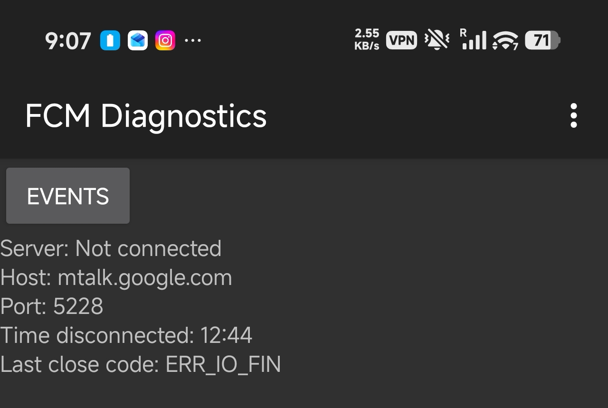
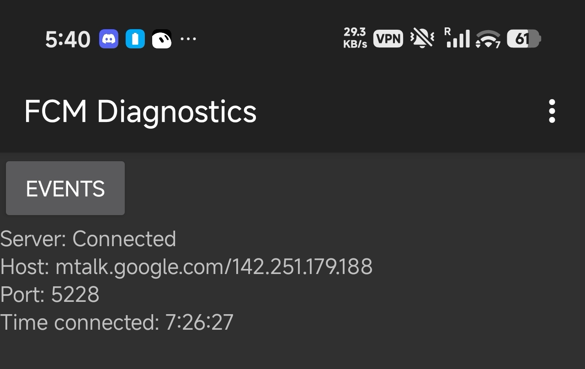

# FCMHeartbeat (为小米HyperOS设计）

[English](README.md) | **中文**

一个可以防止小米HyperOS限制谷歌FCM通知推送服务的简易辅助工具。无需root或Shizuku；开箱即用即可。

## 技术分析

在部分小米HyperOS系统版本中，其电池优化机制会在锁屏状态下限制谷歌FCM服务的后台活动和网络连接，影响App通知的正常推送。该机制会导致FCM服务经常已`ERR_IO_FIN`或`ERR_IO_WRITE`等错误断开连接。在HyperOS 3上，设置Gboard为当前输入法会防止系统对FCM施加限制（因为Gboard会连接谷歌服务进程），但该方法因额外的电池管理机制已在HyperOS 4上失效。

---

执行后台活动限制的系统进程是HyperOS电池管理服务Greezer，并且针对FCM服务的限制仅在国行机型上生效；在国际版机型上，Greezer会豁免所有谷歌服务以确保不会受到后台限制。

熄屏30秒后，Greezer会直接冻结GMS服务进程（日志里会显示`screen_off`、`from system`等理由）并关闭和阻止网络连接，导致FCM会立刻以`ERR_IO_FIN`断开连接。任何唤醒触发（如服务广播、连接调用等）只会允许FCM活跃5秒，之后会被Greezer再次冻结。
该冻结措施会防止GMS触发定时重连操作，导致即使唤醒屏幕后可能无法让FCM重新连接，除非重新开启或切换网络。

在国行机型上还有一个“快速冻结”机制：熄屏1分钟后，Greezer会冻结所有GMS进程，但不会关闭网络连接。但是，GMS在该状态仍然不会保持后台运行，即使不会立刻断开连接，除非唤醒触发导致Greezer暂时启动GMS。
该机制由`mGmsLimitEnabled`设置控制（默认开启），并且可以通过`dumpsys greezer IM GMS disable`调试指令暂时禁用（重启后失效）。
（该机制也存在于HyperOS 3上，但只会针对其他用户空间的GMS进程，并且仅限制唤醒锁和网络策略）

Greezer不会根据进程优先级进行逻辑判断：通过拥有唤醒锁和谷歌服务连接的应用程序提高GMS的优先级不会防止Greezer施加限制。

---

但是，如果有“受保护的进程”拥有对GMS服务进程的连接，Greezer将不会限制FCM的后台活动。

如果该应用程序是当前输入法（熄屏时除外）、创建了虚拟显示实例、或正在使用相机/震动/音频/定位功能，系统将会把它视为“受保护的进程”。在该情况下，Greezer会直接跳过冻结机制的执行（并且在系统日志中显示该逻辑）。

所以，仅通过唤醒锁和谷歌服务连接不会让系统视为“受保护的进程”；它需要符合以上至少一个条件才行。FCMHeartbeat利用的就是这个机制。
在HyperOS 3上，Gboard（设为当前输入法时）也被系统视为“受保护的进程”，但HyperOS 4在熄屏后将不再视为如此；这是为什么该方法不再有效。

虽然快速冻结机制仍然会执行，但可以通过持续请求谷歌服务进程来让FCM保持后台活跃。

## 其他系统（仅代码分析）

### ColorOS 17

ColorOS仅会在当前网络无法连接谷歌服务器时限制GMS的后台活动和网络连接。如果当前网络可以访问谷歌服务器，系统不会对GMS施加任何针对性限制。
唯一会影响FCM的是“睡眠待机优化”功能；它会限制除系统服务外的所有网络连接。在系统设置中关闭后就可以防止此类限制。
**所以，在ColorOS上无需FCMHeartbeat等辅助工具来保证FCM的后台活动。**

## 该工具使用的机制

FCMHeartbeat通过创建一个虚拟显示实例来让系统视为“受保护的进程”。该豁免逻辑在熄屏时依然生效。

启动该工具或开机时，它会启动一个`specialUse`前台服务并保持唤醒锁来确保后台活跃。
它会与谷歌FCM注册服务（`com.google.android.c2dm.intent.REGISTER`）和谷歌广告识别服务（`com.google.android.gms.ads.identifier.service.START`）建立连接，并且创建一个没有Surface的1x1虚拟显示实例。
因为它不会进行任何渲染，所以该方法不会影响电池续航，并且无需任何特殊权限。

该工具的服务也会每4秒向谷歌广告识别服务发送请求，导致快速冻结机制重新把FCM变成活跃状态。它会重复解冻FCM进程来保证其后台活跃。因为该快速冻结机制不会限制网络连接，所以重新冻结时不会直接导致FCM断开连接。

该机制经过测试在运行HyperOS版本`4.0.4.0.XPLCNXM.D02`的REDMI Turbo 5 Max上证明有效。系统日志显示Greezer主动跳过了冻结机制的执行，并且期间没有看到任何FCM断开连接的迹象。 

| 使用工具前 | 使用工具后 |
|---|---|
|  |  |

## 使用方法

- 为该工具打开自启动开关并将省电策略设置为“无限制”
- 打开该工具以开启后台进程
- 点击右上角的诊断按钮来打开FCM诊断页面
    - 可能需要双击"Events"按钮才能正常刷新状态
- 在切换器页面上锁定窗口以防止进程中断。通过清理内存按钮关闭时将不会重新启动服务。
